# TCEA EduCover — Full Project Workflow

> **Project:** Assignment Front Page Generator for Techno College of Engineering Agartala
> **Author:** Sani Shil
> **Stack:** PHP · MySQL · AngularJS 1.x · Bootstrap 5 · Chart.js · jsPDF + html2canvas · PHPMailer
> **Server:** XAMPP (Apache + MySQL) — local at `localhost/college/`, live at `myassignment.infinityfreeapp.com`

---

## 1. High-Level Architecture

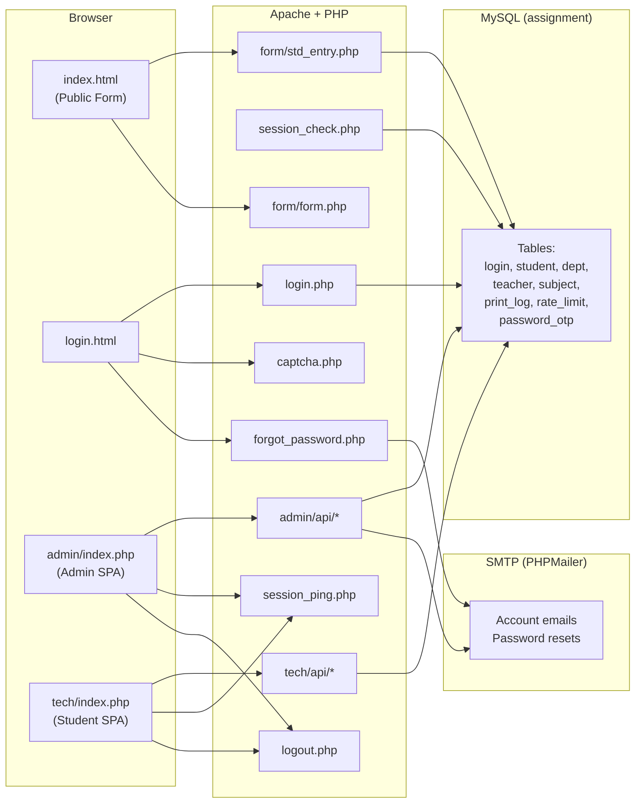

---

## 2. User Roles & Access Matrix

| Role | Entry Point | Dashboard | Manages |
|------|------------|-----------|---------|
| **Public (Guest)** | `index.html` → `form/form.php` | ✗ | Fill form → download PDF cover page |
| **Admin** | `login.html` → `admin/index.php` | ✓ (Chart.js) | Departments, Subjects, Teachers, Users (create/deactivate/reset), Students (view/delete), Active users, Profile |
| **Student** | `login.html` → `tech/index.php` | ✓ (Chart.js) | Departments, Subjects, Teachers (view/add/edit/delete), Students (view/delete), Profile |

> [!NOTE]
> Admin and Student portals share the same sidebar layout and nearly identical API endpoints under `admin/api/` and `tech/api/` respectively. The admin portal additionally has a **User Section** for creating accounts, deactivating users, and resetting passwords.

---

## 3. Complete Request Flow

### 3.1 Public Form — Cover Page Generation

```mermaid
sequenceDiagram
    participant U as Student (Browser)
    participant F as form/form.php
    participant API as form/* APIs
    participant DB as MySQL
    participant PDF as jsPDF + html2canvas

    U->>F: Opens index.html (AngularJS loads form.php into ng-view)
    F->>DB: Query dept table for department <select> options
    F-->>U: Render form (3 sections)

    Note over U: Section 1: Student Details
    U->>API: checkStudentID() → check_student.php
    API->>DB: SELECT * FROM student WHERE std_id = ?
    API-->>U: Auto-fill name, dept, TU roll if returning student

    Note over U: Section 2: Course & Submission
    U->>API: subjects_view() → subject_gets.php
    API->>DB: SELECT subjects WHERE dept + sem + course match
    API-->>U: Populate subject dropdown
    U->>API: subjects_code_view() → subject_code_gets.php
    API-->>U: Auto-fill subject code

    Note over U: Section 3: Submitted To (Faculty)
    U->>API: tech_view() → get_faculty.php
    API->>DB: SELECT teacher WHERE dept_name = ?
    API-->>U: Populate faculty dropdown
    U->>API: designation_view() → get_faculty_designation.php
    API-->>U: Auto-fill designation

    U->>U: Click "Download cover page"
    U->>API: executeFunctions() → std_entry.php
    API->>DB: INSERT or UPDATE student + INSERT print_log
    API-->>U: { status: "success" }
    U->>PDF: printPDF() — show hidden A4 div, html2canvas → jsPDF → save PDF
    U-->>U: PDF downloaded
```

### 3.2 Authentication Flow

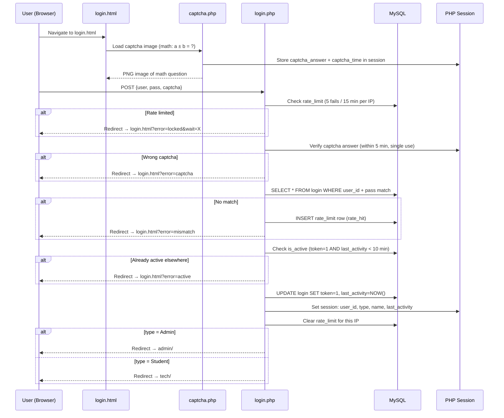

### 3.3 Session Management & Idle Logout

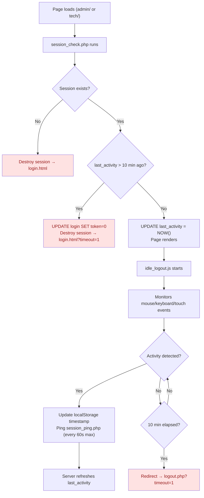

> [!IMPORTANT]
> **Dual-layer idle timeout:** The server enforces a 10-minute session timeout (`session_check.php` + `session_ping.php`), and the browser independently tracks idle time via `idle_logout.js` with `localStorage` sharing across tabs. Both must agree the session is alive.

### 3.4 Forgot Password Flow

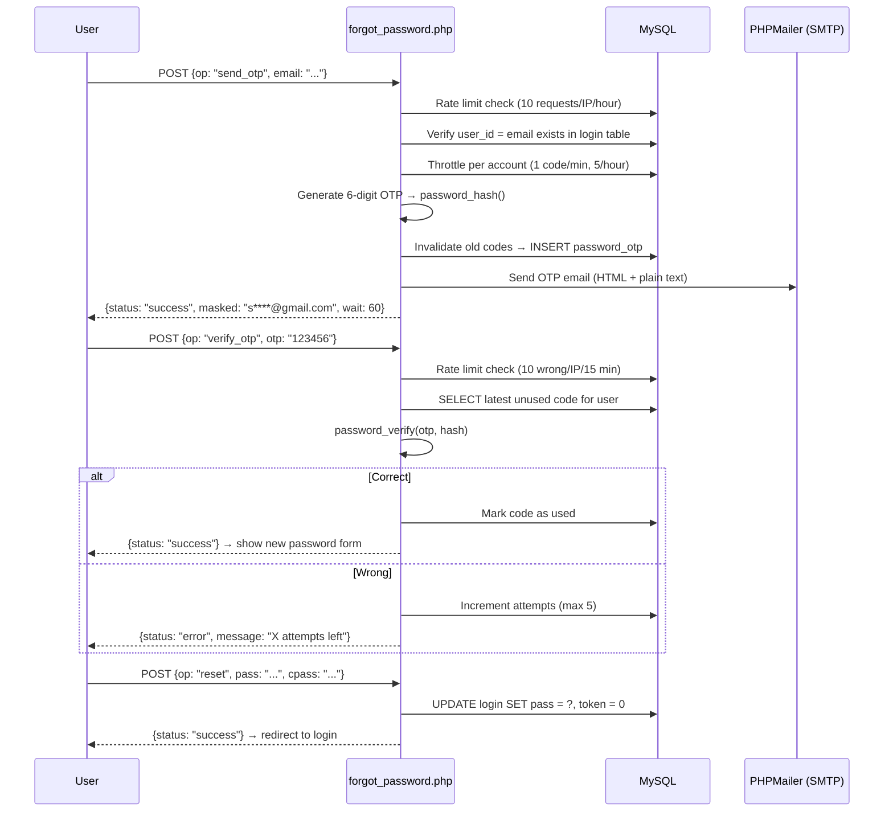

---

## 4. Admin SPA Workflow (AngularJS)

### 4.1 Routing (`admin/controller/main.js`)

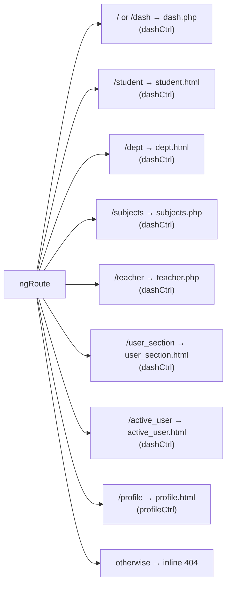

### 4.2 CRUD Operations

Each management module follows the same pattern:

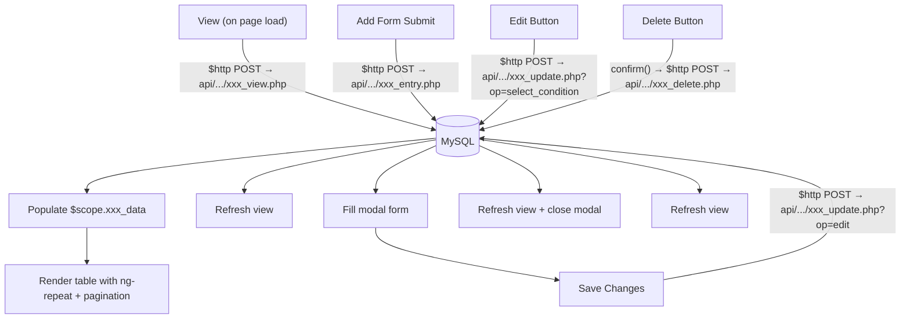

**API endpoints by module:**

| Module | Entry | View | Edit/Update | Delete |
|--------|-------|------|-------------|--------|
| **Department** | `Dept/dept_entry.php` | `Dept/dept_view.php` | `Dept/edit_update.php` | `Dept/dept_delete.php` |
| **Subject** | `subject/subject_entry.php` | `subject/subject_view.php` | `subject/subject_update.php` | `subject/subject_delete.php` |
| **Teacher** | `teacher/teacher_entry.php` | `teacher/teacher_view.php` | `teacher/teacher_update.php` | `teacher/teacher_delete.php` |
| **Student** | *(from public form)* | `std/std_view.php` | — | `std/std_delete.php` |
| **User** | `user/user_entry.php` | `user/user_view.php` | `user/user_edit_update.php` | `user/user_delete.php` |

> [!TIP]
> The **Student (tech)** portal has the same API structure under `tech/api/` without the User management section.

### 4.3 Dashboard Features

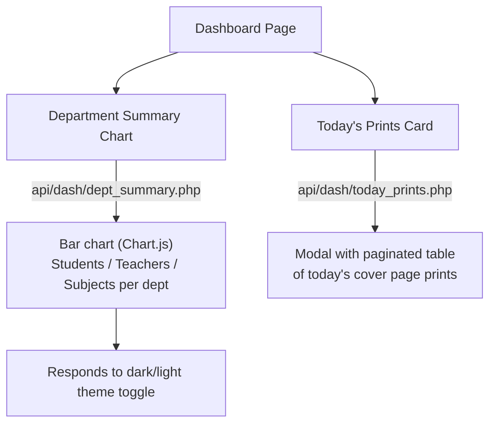

---

## 5. Database Schema (Inferred)

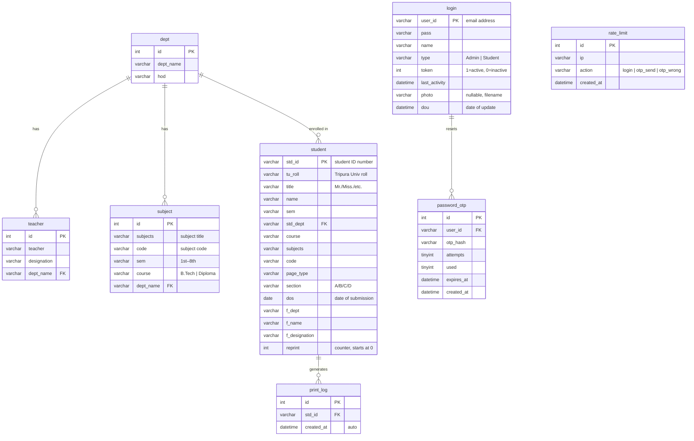

---

## 6. Security Mechanisms

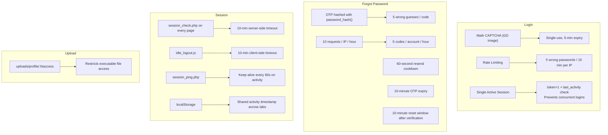

> [!WARNING]
> Passwords in the `login` table are stored in **plain text** (compared directly in `login.php`). The OTP codes use `password_hash()`, but login credentials do not. This is a known security concern.

---

## 7. File Structure & Responsibilities

```
college/
├── index.html                 # Public entry → AngularJS SPA shell
├── login.html                 # Login page (standalone, no framework)
├── login.php                  # Auth handler: captcha + rate limit + session
├── logout.php                 # Clear token + destroy session
├── captcha.php                # Math CAPTCHA image generator (GD)
├── session_check.php          # Guard: included at top of admin/ & tech/
├── session_ping.php           # AJAX keep-alive for idle_logout.js
├── forgot_password.php        # OTP send → verify → reset password
├── mail_config.php            # SMTP credentials (gitignored)
├── 404.html                   # Custom 404 page
├── .htaccess                  # ErrorDocument 404 routing
│
├── form/                      # Public form APIs
│   ├── form.php               # Main form template (injected via ng-view)
│   ├── std_entry.php           # Save/update student + print_log
│   ├── check_student.php       # Auto-fill returning student
│   ├── subject_gets.php        # Subjects by dept+sem+course
│   ├── subject_code_gets.php   # Subject code by name
│   ├── get_faculty.php         # Teachers by department
│   └── get_faculty_designation.php  # Designation by teacher name
│
├── admin/                     # Admin portal (protected)
│   ├── index.php              # SPA shell (session_check + sidebar + ng-view)
│   ├── controller/main.js     # AngularJS routes + all CRUD controllers
│   ├── pages/                 # Partial templates
│   │   ├── dash.php           # Dashboard (chart + today's prints)
│   │   ├── dept.html          # Department management
│   │   ├── student.html       # Student records viewer
│   │   ├── subjects.php       # Subject management
│   │   ├── teacher.php        # Teacher management
│   │   ├── user_section.html  # Create/edit/delete users
│   │   ├── active_user.html   # Currently active users
│   │   └── profile.html       # My profile + change password
│   └── api/                   # JSON APIs
│       ├── connect.php        # DB connection (shared)
│       ├── profile.php        # Profile photo upload
│       ├── change_pass.php    # Change own password
│       ├── dash/              # dept_summary.php, today_prints.php
│       ├── Dept/              # dept_entry, dept_view, dept_delete, edit_update
│       ├── std/               # std_view, std_delete
│       ├── subject/           # subject_entry, subject_view, subject_update, subject_delete
│       ├── teacher/           # teacher_entry, teacher_view, teacher_update, teacher_delete
│       └── user/              # user_entry, user_view, user_edit_update, user_delete,
│                              # user_reset_pass, deactivate, account_mail
│
├── tech/                      # Student portal (protected, same structure as admin)
│   ├── index.php
│   ├── controller/main.js
│   ├── pages/                 # Same partials minus user_section & active_user
│   └── api/                   # Same API structure minus user/
│
├── assets/
│   ├── css/
│   │   ├── modern.css         # Shared theme (light/dark, sidebar, cards, tables)
│   │   └── form.css           # Public form styles
│   ├── js/
│   │   ├── angular.min.js     # AngularJS 1.x
│   │   ├── angular-router.min.js
│   │   ├── angular-cookies.min.js
│   │   ├── theme.js           # Light/dark toggle (localStorage persistence)
│   │   ├── toast.js           # Toast notification utility
│   │   ├── idle_logout.js     # Client-side idle timeout
│   │   └── profile_photo.js   # Profile photo upload/change handler
│   ├── main.js                # Public form AngularJS app (routes + PDF logic)
│   └── TCEA_Format_Paper.pdf  # Downloadable format paper
│
├── lib/
│   ├── mailer.php             # Reusable send_mail() + reply_now()
│   ├── profile_photo.php      # Photo validation helper
│   ├── rate_limit.php         # IP-based rate limiting (rate_wait, rate_hit, rate_clear)
│   └── PHPMailer/             # PHPMailer library (Exception, PHPMailer, SMTP)
│
├── img/                       # Static images
│   ├── campus.jpg / .webp     # Hero photo (login + form pages)
│   └── final_tcea.jpg         # College logo / favicon
│
└── uploads/
    └── profile/               # User profile photos
        └── .htaccess          # Security: restrict script execution
```

---

## 8. Theme System

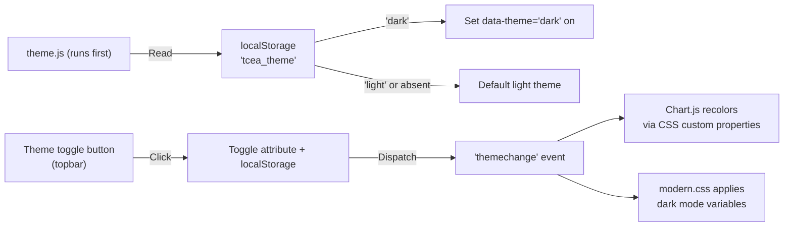

---

## 9. PDF Generation Workflow

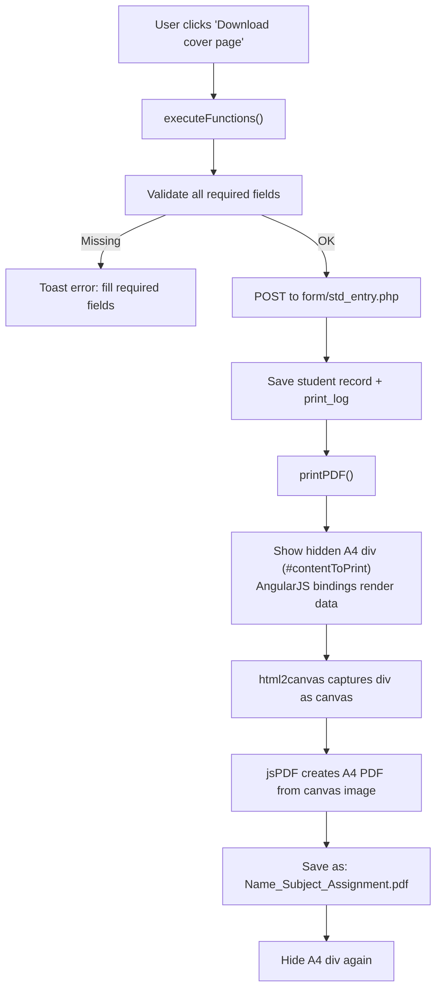

---

## 10. Email System

| Feature | Trigger | Template |
|---------|---------|----------|
| **Password Reset OTP** | "Forgot password?" on login page | 6-digit code, 10-min expiry, HTML email |
| **New Account Credentials** | Admin creates user (`user/user_entry.php`) | Welcome email with login ID + generated password |
| **Password Reset by Admin** | Admin resets user password (`user/user_reset_pass.php`) | New password notification email |

> [!NOTE]
> All emails are sent via SMTP using **PHPMailer**. Configuration lives in `mail_config.php` (gitignored). The `lib/mailer.php` helper provides `reply_now()` to send the HTTP response immediately and continue sending the email in the background, so the user doesn't wait for SMTP.

---

## 11. Deployment

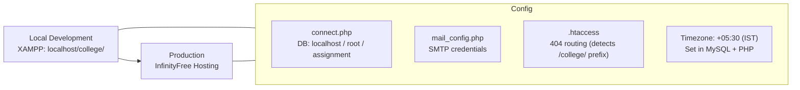

**Setup steps:**
1. Clone repo → XAMPP `htdocs/college/`
2. Start Apache + MySQL
3. Import database schema into `assignment` database
4. Copy `mail_config.example.php` → `mail_config.php` and fill SMTP credentials
5. Access at `http://localhost/college/`
